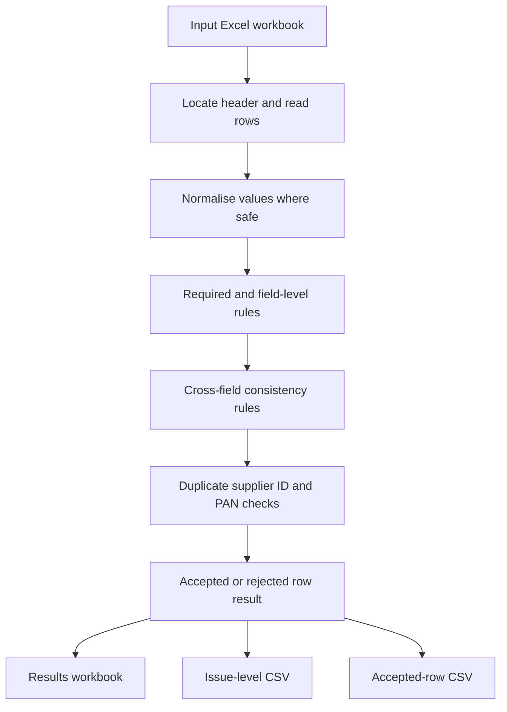

# Validation flow

This page describes the implemented processing sequence in the demo. It is a local file-processing workflow; it does not connect to a portal or external system.

## Process

## Row decision

- A row with one or more **errors** is rejected.
- A row with warnings but no errors remains accepted and carries the warning into the report.
- A workbook-level structural problem, such as a missing required header or duplicate header, stops the run rather than producing misleading row results.

## Output handling

All output files are written to the chosen local output directory. The source workbook is read, not modified. The accepted-row CSV is an example export for a hypothetical next step; it is not transmitted to another system.

## Important boundary

The validator checks whether values conform to the demo's defined rules. It does not establish that a supplier, PAN or GSTIN is genuine, registered or authorised.
